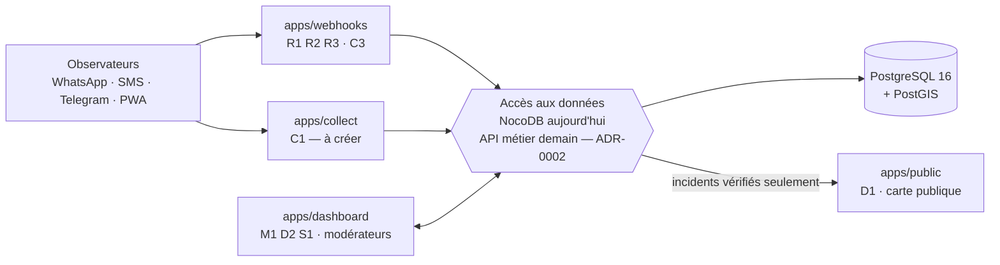

# Situation Room – Africa ElectionLab 🌍

**Boîte à outils open source pour l'observation citoyenne des élections en Afrique.**
Recevoir les signalements des observateurs (WhatsApp, SMS, formulaire hors ligne…), les vérifier dans un espace privé, publier les incidents vérifiés sur une carte publique.

**100 % auto-hébergeable · frugal (VPS 2 Go) · sans cloud propriétaire obligatoire · AGPL-3.0**

Une initiative d'**AfricTivistes** (programmes **AHEAD Africa — Africa ElectionLab** et **Digitalise Youth #Tech4Good**), construite à partir des besoins exprimés par **45 organisations de la société civile dans 18 pays** (consultation Jokkoondiral, 2026).

---

## 🧭 Du besoin au code

La Situation Room n'est pas une application unique : c'est une **boîte à outils de 34 outils**, chacun identifié par un **code** (C1, R2, M3…) et rattaché à un besoin réel.

```
Besoin exprimé par les OSC  →  Outil (code)  →  Dossier du monorepo  →  Issue « [CODE] tâche »
« WhatsApp voulu par 40 »   →  R1             →  apps/webhooks         →  [R1] Télécharger les médias
```

| Famille | Codes | Rôle | Outils | MVP |
|---|---|---|---|---|
| 📥 [Collecte terrain](./docs/outils/collecte.md) | C1–C7 | Signaler depuis n'importe quel téléphone, même sans internet | 7 | C1, C3 |
| 📡 [Réception multi-canal](./docs/outils/reception.md) | R1–R5 | Transformer chaque canal en signalement normalisé, rattaché à un observateur | 5 | R1, R2, R5 |
| 🔎 [Vérification](./docs/outils/verification.md) | M1–M6 | Trier, sceller les preuves, qualifier, tracer chaque décision | 6 | M1–M4 |
| 📢 [Diffusion et alertes](./docs/outils/diffusion.md) | D1–D5 | Carte publique des vérifiés, carte interne, alertes, rapports | 5 | D1, D2 |
| 📊 [Analyse et archives](./docs/outils/analyse.md) | A1–A4 | Statistiques, export, conservation et effacement | 4 | — |
| 🧱 [Socles transverses](./docs/outils/socles.md) | S1–S7 | Identité, multi-organisation, sécurité, langues, déploiement, référentiels, docs | 7 | S1, S3–S7 |

➡️ **[Catalogue complet des 34 outils](./docs/outils/README.md)** · [Besoins et matrice besoins × outils](./docs/BESOINS.md) · [Feuille de route](./docs/ROADMAP.md) · [Décisions ouvertes](./docs/decisions/README.md)

**État :** 10 outils amorcés, 24 à créer. Le MVP (17 outils) vise un premier scrutin pilote début 2027.

---

## 🏗️ Architecture



| Couche | Technologie | Pourquoi |
|---|---|---|
| Site public | **Astro 5** + Leaflet | Pages légères pour la 3G, carte sans Google Maps |
| Dashboard | **Refine.js + React 19 + Vite** | Back-office CRUD rapide, utilisable sur mobile |
| Réception | **Node.js / Express** | Webhooks WhatsApp, SMS, Telegram |
| Données | **PostgreSQL 16 + NocoDB** | Base solide ; interface d'administration type tableur |
| Déploiement | **Docker Compose + Nginx** | Un petit VPS, aucun verrou fournisseur |

Détails : [docs/ARCHITECTURE.md](./docs/ARCHITECTURE.md) · [docs/TECHNICAL_REFERENCE.md](./docs/TECHNICAL_REFERENCE.md)

---

## 📁 Structure du monorepo

```text
apps/
  public/       → Site public Astro ............ D1 (carte), D4, D5, C1 possible
  dashboard/    → Situation Room privée Refine . M1, D2, S1, C4, A1, M5, M6
  webhooks/     → Réception multi-canal Node ... R1, R2, R3, C3, R4, C5, D3
  (collect/ api/ voice/ … créées avec leur premier code — voir docs/AJOUTER_UN_OUTIL.md)
packages/
  shared/       → Types et constantes communs (@situation-room/shared) — M3, S1, S4
infra/postgres/ → Schéma SQL ........................ M3, M4, R5, S2, S6
docker/         → Dockerfiles, Nginx ................ S3, S5
scripts/        → setup, seed, scripts GitHub ....... S5, S6
docs/
  outils/       → Catalogue : une fiche par outil, par domaine
  decisions/    → Décisions d'architecture (ADR)
  BESOINS.md · ROADMAP.md · ARCHITECTURE.md · METHODOLOGY.md …
```

Le projet grandit **par outil** : un nouvel outil devient un dossier dans une app existante, une nouvelle app `apps/<nom>` ou un package `packages/<nom>` — règle fixée par [ADR-0001](./docs/decisions/0001-structure-monorepo.md), mode d'emploi dans [docs/AJOUTER_UN_OUTIL.md](./docs/AJOUTER_UN_OUTIL.md).

---

## 🚀 Démarrer en local

Prérequis : Node.js ≥ 20, pnpm ≥ 10, Docker.

```bash
git clone https://github.com/AfricTivistes/situation-room.git
cd situation-room
bash scripts/setup.sh      # .env, dépendances, PostgreSQL + NocoDB
pnpm seed                  # optionnel : 28 incidents de démonstration (token NocoDB requis dans .env)
pnpm dev                   # toutes les apps
```

| Service | URL |
|---|---|
| NocoDB (administration des données) | http://localhost:8080 |
| Site public | http://localhost:4321 |
| Dashboard | http://localhost:5173 |
| Webhooks | http://localhost:3000 |

Autres commandes : `pnpm typecheck`, `pnpm build`, `pnpm dev:public|dev:dashboard|dev:webhooks`. Production : [docs/DEPLOYMENT.md](./docs/DEPLOYMENT.md).

---

## 🤝 Contribuer (La Forge Citoyenne)

L'observation électorale n'est pas qu'une affaire de code : **journalistes, juristes, designers, traducteurs et fact-checkeurs** ont autant d'outils à leur portée que les développeurs.

1. **Trouve ton profil** dans [SKILLS_MAP.md](./SKILLS_MAP.md) → il te donne des outils et une première tâche.
2. **Lis la fiche de l'outil** dans [docs/outils/](./docs/outils/README.md).
3. **Prends une issue** dont le titre commence par le code (`[R1] …`), ou ouvre-la avec le modèle « Tâche sur un outil ». Les issues MVP sont dans le jalon **MVP**.
4. **Ouvre une pull request** en citant le code de l'outil — processus dans [CONTRIBUTING.md](./CONTRIBUTING.md).

Une OSC veut l'installer et l'adapter à son pays ? → [docs/PERSONNALISER.md](./docs/PERSONNALISER.md).
Agents IA (Claude, Cursor…) → [AGENTS.md](./AGENTS.md).

---

## 📚 Documentation

| Document | Pour qui | Contenu |
|---|---|---|
| [docs/outils/](./docs/outils/README.md) | Contributeurs | Les 34 outils, fiche par fiche |
| [docs/BESOINS.md](./docs/BESOINS.md) | Tous | Résultats de la consultation, matrice besoins × outils |
| [docs/ROADMAP.md](./docs/ROADMAP.md) | Pilotage, contributeurs | Phases MVP / V1 / V2, scrutins visés |
| [docs/decisions/](./docs/decisions/README.md) | Tech lead, pilotage | Décisions d'architecture prises et à prendre |
| [SKILLS_MAP.md](./SKILLS_MAP.md) | Nouveaux venus | Quel outil pour quel profil |
| [docs/AJOUTER_UN_OUTIL.md](./docs/AJOUTER_UN_OUTIL.md) | Développeurs | Brancher un nouvel outil ou projet |
| [docs/PERSONNALISER.md](./docs/PERSONNALISER.md) | OSC qui déploient | Forker, adapter, rester à jour |
| [docs/METHODOLOGY.md](./docs/METHODOLOGY.md) | Fact-checkeurs, juristes | Nomenclature et circuit de vérification (à rédiger) |
| [docs/ARCHITECTURE.md](./docs/ARCHITECTURE.md) · [TECHNICAL_REFERENCE.md](./docs/TECHNICAL_REFERENCE.md) · [SCHEMA.md](./docs/SCHEMA.md) | Développeurs | Architecture, choix techniques, base de données |
| [docs/DEPLOYMENT.md](./docs/DEPLOYMENT.md) | DevOps | Mise en production |
| [docs/PROJECT_OVERVIEW.md](./docs/PROJECT_OVERVIEW.md) | Partenaires, bailleurs | Vision, valeurs, impact |

---

## 📄 Licence

**AGPL-3.0** — toute version modifiée mise à disposition d'autres personnes, y compris en ligne, doit rester open source. Ce bien commun numérique reste ouvert pour tout le continent.

**Tech Lead :** dofbi & l'équipe IT AfricTivistes.
