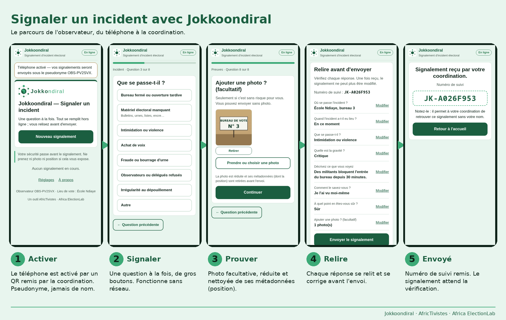
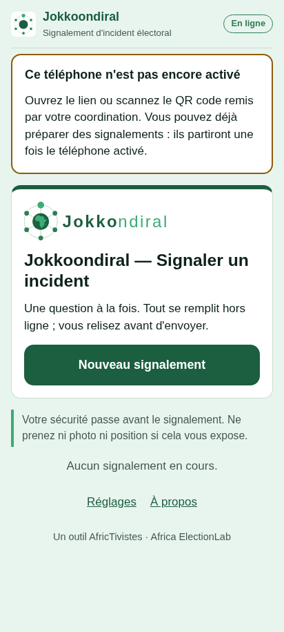
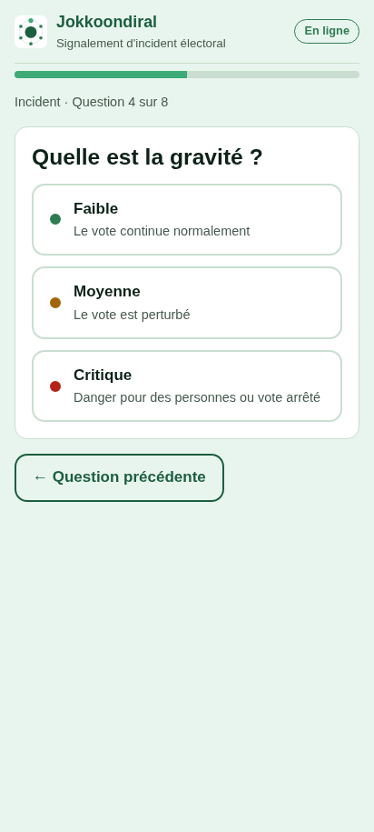
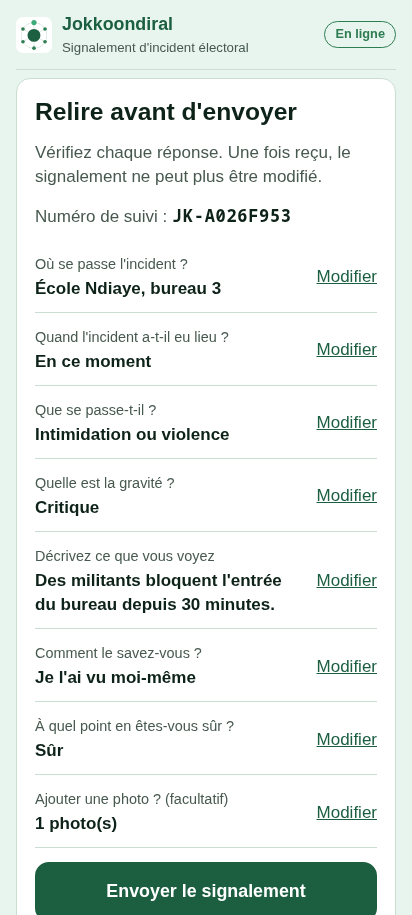
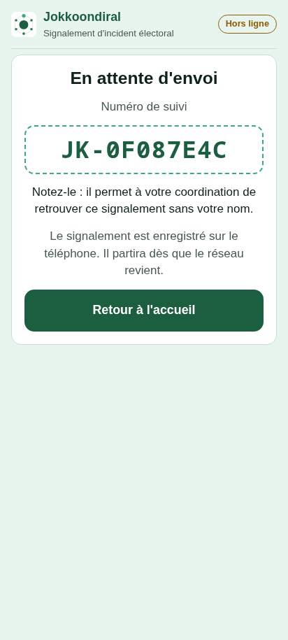
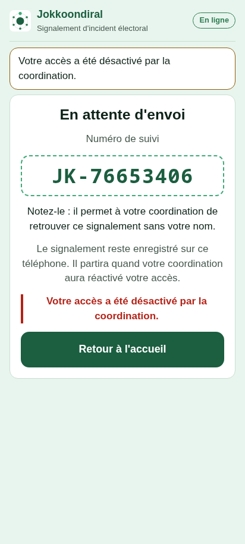

# 📥 Collecte — formulaire de signalement hors ligne (PWA)

**Outils hébergés :** [C1 · Formulaire web hors ligne](../../docs/outils/collecte.md#c1) (MVP).

Un observateur signale un incident électoral depuis le navigateur de son téléphone, **même sans réseau** : une question à la fois, de gros boutons, relecture avant envoi. Le signalement attend sur le téléphone et part dès que la connexion revient. Il arrive dans la file de modération (statut `pending`) via `apps/webhooks`.

Réécriture en TypeScript de [dofbi/collecte-guidee](https://github.com/dofbi/collecte-guidee) (même auteur, AGPL-3.0).

---

## Aperçu



| Accueil (non activé) | Question | Relecture | Hors ligne | Accès coupé |
|---|---|---|---|---|
|  |  |  |  |  |

Présentation non technique (communication, formations) : [docs/APERCU_COLLECTE.md](../../docs/APERCU_COLLECTE.md).

## Ce que fait l'app

| Fonction | Détail |
|---|---|
| Une question à la fois | Pilotée par le protocole JSON (`@jokkoondiral/protocole`) : conditions, règles, question précédente |
| Hors ligne | Service worker (app en cache) + IndexedDB (brouillons, file d'envoi) ; installable sur l'écran d'accueil |
| Relecture | Toutes les réponses, modifiables une à une, avant l'envoi |
| Numéro de suivi | `JK-XXXXXXXX`, affiché avant et après l'envoi |
| Photos | Facultatives, réduites (~200 Ko) et **sans métadonnées EXIF** (position, modèle du téléphone) |
| Position GPS | Facultative, **jamais automatique**, désactivable pour toute l'instance |
| Identification | Téléphone activé par un lien ou QR à usage unique remis par la coordination ; pseudonyme `OBS-XXXXXX`, jamais de nom ; désactivable à distance ([nocodb-registre.md](../../docs/nocodb-registre.md)) |
| Sécurité | Clé propre au téléphone (le serveur n'en garde que l'empreinte) ; purge après envoi (par défaut) ; aucun jeton de base dans le navigateur |
| Langues | Interface FR/EN ; questions traduites dans le protocole ; repli homogène |
| Poids | ~15 Ko gzip de JavaScript, polices système, aucune ressource externe |

## Démarrer

```bash
pnpm dev:collect        # http://localhost:5174 — l'envoi passe par apps/webhooks (pnpm dev:webhooks)
pnpm --filter collect build && pnpm --filter collect preview
pnpm --filter collect test
```

Pour tester l'envoi en local : lancer `pnpm dev:webhooks`, créer un observateur avec `pnpm observateurs ajouter --bureau "Bureau 1"` et ouvrir le lien affiché (il active le navigateur comme un téléphone). Pour un test rapide sans registre : `IDENTIFICATION=codes` côté serveur, `"identification": "codes"` dans `config/instance.json`, et un code de `COLLECT_CODES` dans **Réglages**.

## Déployer

- **Netlify** : le fichier [`netlify.toml`](../../netlify.toml) à la racine ne construit que cette app et relaie `/webhooks/*` vers le serveur de réception. Guide pas à pas avec Render : [TESTER_EN_LIGNE.md](../../docs/TESTER_EN_LIGNE.md).
- **Nginx / Docker** : image `docker/Dockerfile.collect`, servie sous `/collect/` ([DEPLOYMENT.md](../../docs/DEPLOYMENT.md)).

## Personnaliser (sans toucher au code)

| Quoi | Où | Guide |
|---|---|---|
| Couleurs, polices, angles, logo, mode sombre | `config/themes/<nom>/theme.json` | [personnaliser-le-design.md](../../docs/personnaliser-le-design.md) |
| Nom, textes d'accueil et de sécurité, langues, GPS, purge | `config/instance.json` | ci-dessous |
| Questions ajoutées (champs, catégories, sections) | extensions de protocole | [protocoles.md](../../docs/protocoles.md) |

`config/instance.json` :

| Clé | Rôle |
|---|---|
| `nom`, `nom_court`, `description` | Titre de l'app, nom sur l'écran d'accueil du téléphone |
| `theme`, `theme_surcharges` | Thème choisi, et surcharges ponctuelles (ex. `{ "couleurs": { "primaire": "#7A1F3D" } }`) |
| `langues`, `langue_defaut` | Langues proposées dans les réglages |
| `protocole`, `extensions` | Protocole de base et extensions actives (le serveur lit la même configuration) |
| `envoi` | Adresse de réception (`/webhooks/api/collect` derrière Nginx) |
| `identification` | `appareils` (activation par lien) ou `codes` (code saisi) ; même valeur que `IDENTIFICATION` côté serveur |
| `gps` | `facultatif` ou `desactive` |
| `purge_apres_envoi` | Effacer du téléphone un signalement dès qu'il est reçu (recommandé) |
| `textes` | Accueil, consigne de sécurité, mention de l'organisation, par langue |

Changer de configuration au build, sans modifier les fichiers : `JK_THEME=sobre pnpm --filter collect build` ou `JK_INSTANCE=/chemin/instance.json pnpm --filter collect build`.

Le build **échoue avec un message clair** si le protocole, une extension ou le thème est invalide (contraste insuffisant compris).

## Structure

```
config/
  instance.json            → réglages de l'instance (une OSC la copie et l'adapte)
  themes/<nom>/            → theme.json + logo + icône
plugin/jokkoondiral.ts     → plugin Vite : vérifie la config, injecte le thème, génère manifest et service worker
src/
  main.ts                  → écrans : accueil, question, relecture, confirmation, réglages, à propos
  champs.ts                → rendu d'une question selon son type (choix, texte, lieu, photo…)
  store.ts                 → IndexedDB (signalements, photos, réglages)
  sync.ts                  → file d'envoi
  photo.ts                 → réduction et nettoyage des photos
  i18n.ts                  → textes de l'interface FR/EN
  styles.css               → styles, uniquement via les jetons --jk-* du thème
test/theme.test.ts         → thèmes, configuration, interdiction des couleurs en dur
```

## Limites connues

- Pas encore de liste de bureaux de vote (outil S6) : le lieu est saisi librement, GPS facultatif.
- Pas de synchronisation en arrière-plan quand l'app est fermée : l'envoi se fait à l'ouverture, au retour du réseau ou à la demande.
- Les signalements en attente sont stockés en clair dans le navigateur : utiliser un téléphone avec verrouillage d'écran.
- Icône d'installation en SVG : ajouter des PNG 192/512 dans le thème si un appareil ancien l'exige.
