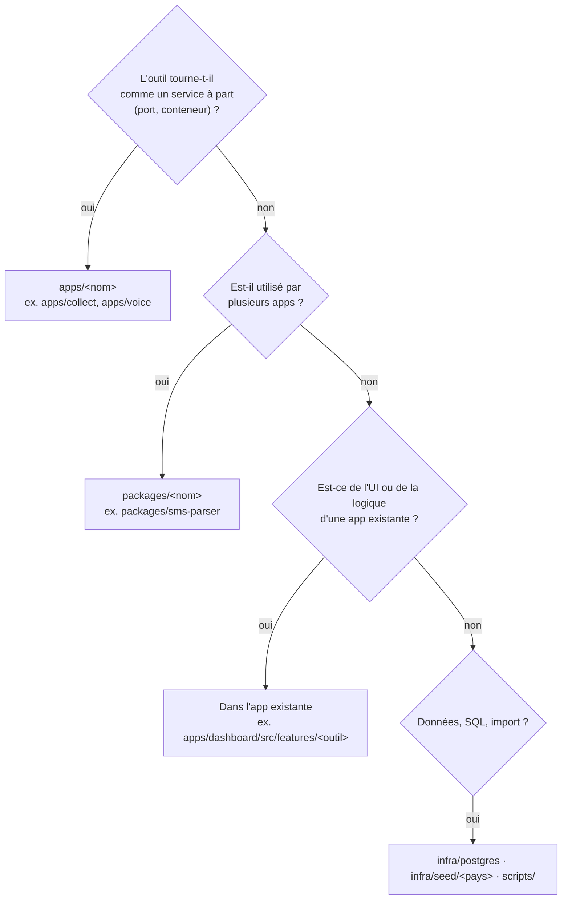

# ➕ Ajouter un outil ou un projet au monorepo

Ce guide explique comment brancher un nouvel outil (ou un projet existant que tu veux faire rejoindre la Situation Room) sans casser le reste. La structure est fixée par [ADR-0001](./decisions/0001-structure-monorepo.md).

## 1. Situer l'outil

1. **Cherche-le dans le [catalogue](./outils/README.md).** 34 outils y sont déjà décrits : il y a de fortes chances que ton idée y soit (code, emplacement prévu, phase).
2. **Il n'y est pas ?** Ouvre une issue avec le modèle **« Proposer une idée / un nouvel outil »** : quel besoin (idéalement un chiffre de [BESOINS.md](./BESOINS.md)), quelle famille, quelles briques open source. Le code (ex. `D6`) est attribué lors de la validation, puis une fiche est ajoutée au fichier de domaine.

## 2. Choisir où le mettre



| Type | Exemples d'outils | Emplacement |
|---|---|---|
| Écran ou fonction d'une app existante | M1, D2, C4, A1 | `apps/dashboard/src/features/<code>-<nom>/` |
| Nouveau canal entrant | R4, C5 | `apps/webhooks/src/handlers/<canal>.ts` |
| Nouvelle app déployable | C1 (`apps/collect`), C6 (`apps/voice`), API métier (`apps/api`) | `apps/<nom>/` |
| Logique partagée | C3 (parseur SMS), S4 (traductions), M2 (preuves) | `packages/<nom>/` |
| Données et schéma | M3, M4, R5, S6 | `infra/postgres/`, `infra/seed/<pays>/` |
| Script ponctuel | C7 (import KoBo), A2 (export) | `scripts/` |

## 3. Créer une nouvelle app ou un package

Checklist :

- [ ] `package.json` : `name` = `<nom>` (app) ou `@situation-room/<nom>` (package), `"private": true`, licence `AGPL-3.0-only`.
- [ ] Scripts `dev`, `build`, `typecheck` (la racine les lance avec `pnpm -r --if-present`).
- [ ] Dépendance aux types communs : `"@situation-room/shared": "workspace:*"`. Les nouveaux types vont dans `packages/shared`, jamais redéfinis localement.
- [ ] `README.md` avec, en tête, la section **« Outils hébergés »** (codes + lien vers les fiches), puis rôle, démarrage, structure.
- [ ] Si l'app se déploie : `docker/Dockerfile.<nom>` + service dans `docker-compose.yml`. Si elle est **optionnelle**, la mettre sous un profil :

  ```yaml
  voice:
    build: { context: ., dockerfile: docker/Dockerfile.voice }
    profiles: ["voice"]          # démarre seulement avec --profile voice
    networks: [internal]
  ```

- [ ] Variables d'environnement documentées dans `.env.example` (avec valeur factice).
- [ ] Mise à jour de la fiche de l'outil (`docs/outils/<domaine>.md`) : rubriques **Où** et **État**.

## 4. Faire rejoindre un projet existant

Tu as déjà un outil (bot, formulaire, script d'analyse) développé ailleurs ?

1. Vérifie la licence : elle doit être compatible avec l'**AGPL-3.0**.
2. Ouvre une issue « nouvel outil » qui décrit le projet, son besoin et l'outil du catalogue qu'il couvre.
3. Importe-le dans `apps/<nom>` ou `packages/<nom>` en conservant l'historique si possible (`git subtree add --prefix=apps/<nom> <url> <branche>`).
4. Adapte-le aux règles communes : pnpm, types de `packages/shared`, aucun cloud propriétaire obligatoire, scripts `dev`/`build`/`typecheck`.
5. Branche-le au reste par le point d'accès commun à la base (voir [ARCHITECTURE.md](./ARCHITECTURE.md)), jamais par un accès direct à PostgreSQL depuis une app publique.

## 5. Règles qui ne changent pas

- **Pas de service cloud propriétaire obligatoire** (AWS, Firebase, Supabase, Vercel…). Un service tiers (Meta, Africa's Talking) est permis s'il est remplaçable et documenté.
- **Frugal** : l'instance complète tient sur un VPS de 2 Go de RAM.
- **Aucune donnée d'observateur** ne sort vers le site public ou les données ouvertes.
- **pnpm** uniquement.
