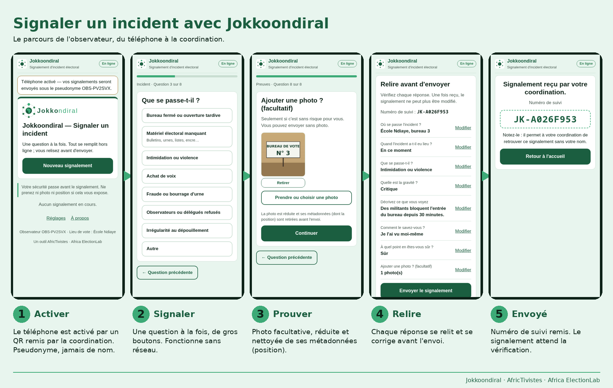
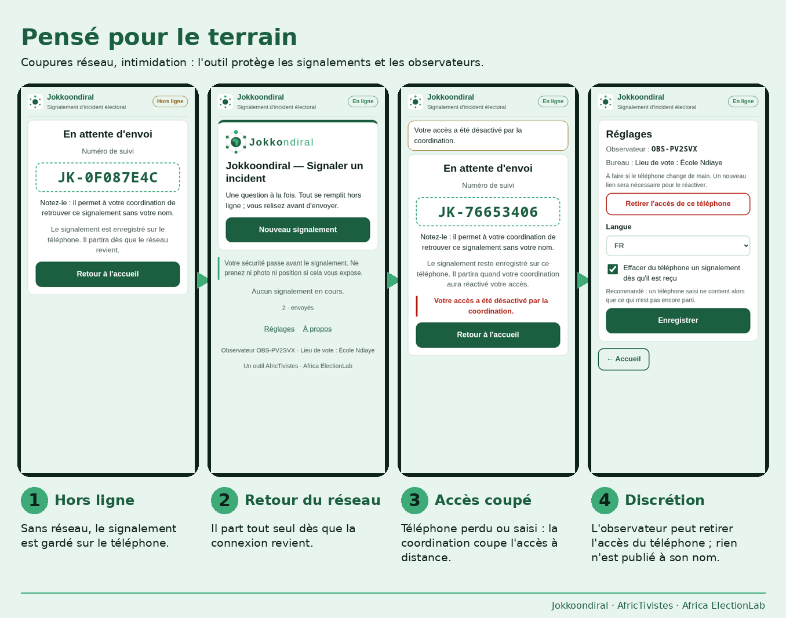
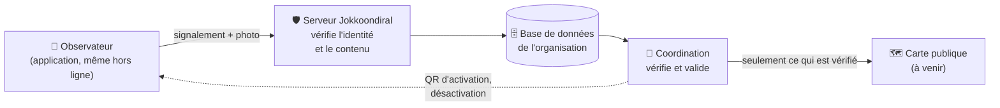
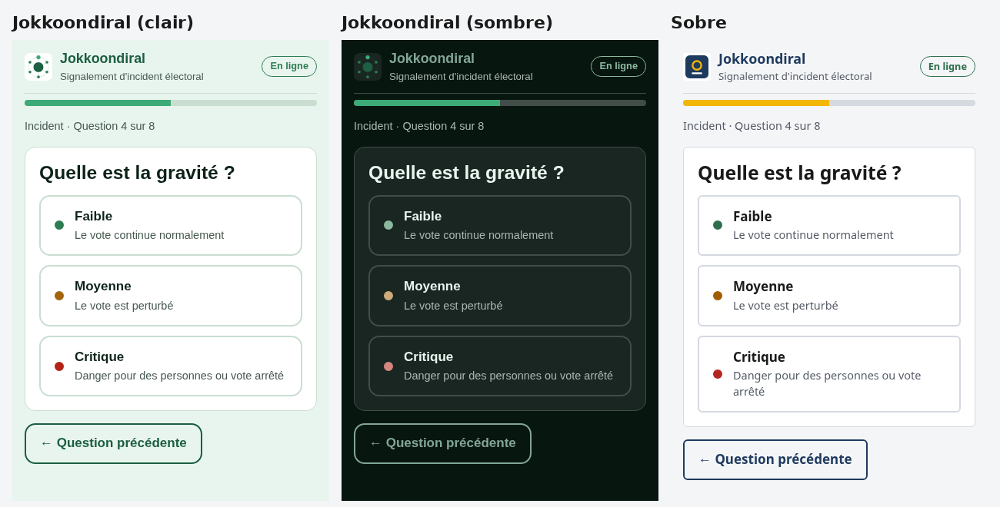

# 📱 Jokkoondiral — l'application de signalement en images

*Document pour la communication, les partenaires et les formations. Langage non technique. Captures réalisées sur un environnement de test, avec des données fictives.*

## En une phrase

**Jokkoondiral permet à un observateur électoral de signaler un incident depuis son téléphone, même sans réseau, sans jamais donner son nom, et de le transmettre à sa coordination, qui le vérifie avant toute publication.**

## Ce que vit l'observateur

| Étape | Ce qu'il voit | Ce qu'il faut retenir |
|---|---|---|
| 1. **Activer** | La coordination lui remet un QR code. Il le scanne : son téléphone est activé. | Pas de compte à créer, pas de mot de passe, **pas de nom** : un pseudonyme (ex. `OBS-7K2Q9M`). |
| 2. **Signaler** | Une question à la fois, avec de gros boutons : où, quand, quoi, quelle gravité. | Simple à utiliser dans la foule, sous pression, sur un téléphone modeste. |
| 3. **Prouver** | Il peut ajouter une photo s'il le juge sans risque. | La photo est allégée et **nettoyée de ses métadonnées** (dont la position) avant l'envoi. |
| 4. **Relire** | Il relit toutes ses réponses et peut en corriger une. | Moins d'erreurs, des données fiables. |
| 5. **Envoyé** | Un numéro de suivi s'affiche (ex. `JK-A026F953`). | Ce numéro permet de retrouver le signalement **sans le nom de l'observateur**. |

## Pensé pour les réalités du terrain

- **Sans réseau, rien n'est perdu.** Le signalement est gardé sur le téléphone et part tout seul quand la connexion revient. 41 des 45 organisations consultées citent les coupures d'internet pendant les élections.
- **Un téléphone perdu ou saisi se coupe à distance.** La coordination désactive l'accès en quelques secondes : le téléphone ne peut plus rien envoyer.
- **Rien n'est publié au nom de l'observateur.** Il est connu seulement par un pseudonyme, et les signalements en attente peuvent être effacés du téléphone dès leur réception.
- **Rien n'est publié sans vérification.** Chaque signalement arrive « en attente » ; la coordination le vérifie avant toute diffusion.

## Comment ça circule

Chaque organisation **héberge ses propres données**. L'outil est libre (licence AGPL-3.0) et peut être adapté à chaque pays : couleurs et logo, langues, questions supplémentaires.

## Personnalisable

Une organisation change l'apparence (couleurs, logo, polices) sans toucher au code, et l'outil vérifie que tout reste lisible.

## Messages clés (pour les réseaux sociaux, les présentations)

- « Signaler un incident électoral en moins de trois minutes, même sans réseau. »
- « Pas de nom, pas de mot de passe : un QR code et un pseudonyme. »
- « Rien n'est publié sans vérification. »
- « Un outil libre, construit avec 45 organisations de la société civile de 18 pays. »

## Où en est-on ? (novembre 2026)

| Fonction | État |
|---|---|
| Signaler (formulaire guidé, hors ligne, photo, relecture) | ✅ Testé en ligne sur un vrai téléphone |
| Activer et désactiver un observateur | ✅ Testé ; écran de gestion pour la coordination à venir |
| Vérification par la coordination (file de modération) | 🔜 À venir |
| Liste des lieux et bureaux de vote | 🔜 À venir |
| Carte publique des incidents vérifiés | 🔜 À venir |

Pour aller plus loin : [catalogue des outils](./outils/README.md) · [besoins exprimés par les organisations](./BESOINS.md) · [feuille de route](./ROADMAP.md).

---

*Captures réalisées le 26 novembre 2026 sur un environnement de test, avec des données fictives. Les écrans peuvent évoluer.*
