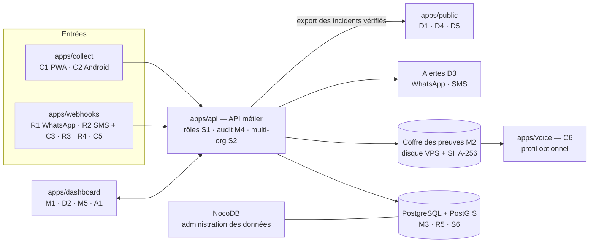

# Architecture technique – Jokkoondiral

Deux vues : **ce qui tourne aujourd'hui** dans le dépôt, et **l'architecture cible** décrite par le document « Orientation des besoins ». Le passage de l'une à l'autre dépend d'une décision ouverte ([ADR-0002](./decisions/0002-couche-acces-donnees.md)).

## 1. Aujourd'hui

```
┌─────────────────────────────────────────────────────────┐
│                    TERRAIN (observateurs)                │
│              WhatsApp · Telegram · SMS                   │
└──────────────────────┬──────────────────────────────────┘
                       │ Webhooks HTTP POST
                       ▼
┌─────────────────────────────────────────────────────────┐
│      apps/webhooks (Node.js) — R1 · R2 · R3              │
│      Reçoit le texte, insère un signalement "pending"    │
└──────────────────────┬──────────────────────────────────┘
                       │ API REST NocoDB (jeton serveur)
                       ▼
┌─────────────────┐       ┌──────────────────────────────┐
│  PostgreSQL 16  │◄─────►│  NocoDB (admin + API REST)   │
└─────────────────┘       └──────────────┬───────────────┘
                                         │ API REST NocoDB
                     ┌───────────────────┴─────────┐
                     ▼                             ▼
          ┌────────────────────┐       ┌──────────────────────────┐
          │ apps/public (Astro)│       │ apps/dashboard (Refine)  │
          │ D1 — aucune page   │       │ M1 — routes vides        │
          └────────────────────┘       │ ⚠ jeton NocoDB complet   │
                                       │   envoyé au navigateur   │
                                       └──────────────────────────┘
```

Limites connues (détail dans les fiches d'outils) :

- Texte seul : les médias WhatsApp sont ignorés (R1), aucun coffre des preuves (M2).
- Le dashboard embarque un jeton NocoDB complet côté navigateur (`VITE_NOCODB_API_TOKEN`) : contraire à l'exigence « aucun jeton d'API exposé » (S1, S3).
- Pas de journal d'audit (M4), pas de rôles appliqués (S1), pas de notion d'organisation (S2) ni de scrutin (A4).
- `pnpm typecheck` échoue sur deux fichiers existants (`apps/dashboard/src/providers/dataProvider.nocodb.ts`, `apps/webhooks/src/handlers/telegram.ts`).

## 2. Cible



Principes de la cible :

1. **Deux portes d'entrée** : `apps/collect` (formulaire et application, envoi direct dès que le réseau revient) et `apps/webhooks` (canaux tiers). Les deux remettent un signalement **au même format** (types de `packages/shared`).
2. **Un seul point d'accès à la base** : l'API métier applique rôles, journal d'audit et organisation avant toute écriture ; les médias vont au coffre des preuves.
3. **NocoDB reste l'outil d'administration** des données (vue tableur), pas l'API des applications publiques.
4. **Le site public ne reçoit qu'un export des incidents vérifiés**, jamais un accès direct à la base, et aucun champ observateur.
5. **Outils optionnels** (vocal, USSD) = services sous profil Docker Compose.

## 3. Responsabilités

| Application | Public ? | Rôle | Outils |
|-------------|----------|------|--------|
| `apps/public` | ✅ Oui | Carte et rapports des incidents vérifiés | D1, D4, D5 |
| `apps/dashboard` | ❌ Privé | Modération, carte interne, statistiques, comptes | M1, D2, S1, C4, A1, M5, M6 |
| `apps/webhooks` | ❌ Interne | Réception multi-canal, alertes sortantes | R1–R4, C3, C5, D3 |
| `apps/collect` (à créer) | ✅ Oui (formulaire) | Signalement hors ligne | C1 |
| `apps/api` (selon ADR-0002) | ❌ Interne | Écriture, preuves, rôles, audit | S1, M2, M4, S2 |
| NocoDB | ❌ Admin | Administration des données | — |

## 4. Règles d'architecture

1. **Pas de cloud propriétaire obligatoire.** Tout tourne sur Docker, sur un VPS de 2 Go.
2. **Les types sont dans `packages/shared`.** Jamais redéfinis dans les apps.
3. **pnpm exclusivement.**
4. **Aucun jeton d'API NocoDB dans le navigateur** pour toute nouvelle app.
5. **CRUD via l'API NocoDB — règle en révision.** Elle reste valable pour l'existant ; une API métier est recommandée pour l'écriture, les preuves, les rôles et l'audit ([ADR-0002](./decisions/0002-couche-acces-donnees.md)). Ne pas créer de nouvelles routes CRUD Express avant la décision.
6. **Structure du monorepo** : [ADR-0001](./decisions/0001-structure-monorepo.md).

## 5. Pipeline de vérification d'un incident

```
[TERRAIN]     → Signalement reçu (R1/R2/R3, C1) — rattaché à un observateur (R5)
[RÉCEPTION]   → status = "pending" ; preuves scellées (M2) ; horodatage serveur
[DASHBOARD]   → Qualification (M3 : catégorie, gravité, lieu) — chaque changement journalisé (M4)
    ├── Validé → status = "verified" → carte publique (D1), alerte si critique (D3)
    └── Rejeté → status = "rejected" → archivé, invisible du public
[APRÈS]       → statistiques (A1), export (A2), archivage et pseudonymisation (A4)
```

Les règles de vérification elles-mêmes sont dans [METHODOLOGY.md](./METHODOLOGY.md) (à rédiger).
