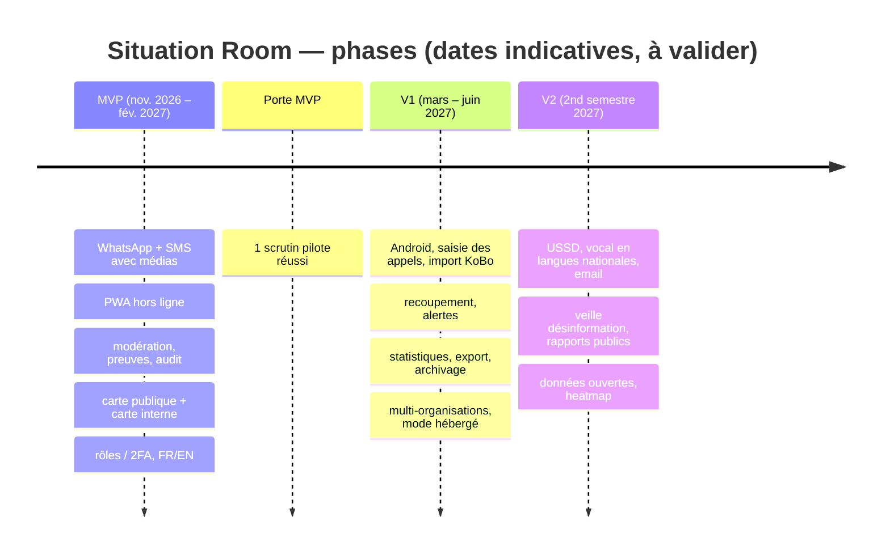

# 🗺️ Feuille de route — phasage des outils

Le MVP vise un **premier scrutin pilote début 2027**. Chaque phase ne s'ouvre qu'une fois sa **porte** franchie : on n'élargit pas avant d'avoir prouvé l'outil sur un vrai scrutin.

> La phase est un attribut de chaque outil : elle dit **quand** il est attendu, pas s'il fait partie du projet. Un contributeur peut commencer un outil V1 ou V2 dès maintenant s'il ne bloque pas le MVP.

## Répartition des 34 outils

| Phase | Outils | Nombre |
|---|---|---|
| **MVP** (nov. 2026 – fév. 2027) | C1, C3, R1, R2, R5, M1, M2, M3, M4, D1, D2, S1, S3, S4 (FR/EN), S5 (auto-hébergé), S6, S7 | 17 |
| **V1** (mars – juin 2027) | C2, C4, C7, M5, D3, A1, A2, A4, S2, S5 (mode hébergé) | 9 + extension de S5 |
| **V2** (second semestre 2027) | C5, C6, R4, M6, D4, D5, A3, S4 (langues nationales) | 7 + extension de S4 |
| **Maintenu** sans nouvel investissement | R3 | 1 |

Les issues GitHub portent le label `phase:mvp`, `phase:v1`, `phase:v2` ou `phase:maintenu`, et les issues MVP sont rattachées au jalon **MVP**.

## Le MVP en une phrase

> Un observateur envoie un signalement par **WhatsApp, SMS ou formulaire hors ligne**, avec photo ou vocal ; il est **rattaché à un observateur enrôlé**, **horodaté et scellé** ; un modérateur le **qualifie** (catégorie, gravité, bureau de vote) sur son téléphone ; une fois vérifié, il apparaît sur la **carte publique**, en français ou en anglais, sur une instance **auto-hébergée** protégée par des **rôles et la double authentification**.

## Scrutins visés

| Période | Pays | Scrutin déclaré | Échéance souhaitée |
|---|---|---|---|
| Nov. 2026 | Afrique du Sud | Municipales | < 3 mois |
| Déc. 2026 | Soudan du Sud | Élections nationales | < 3 mois à < 1 an |
| Janv.–fév. 2027 | Sénégal | Locales, communales, législatives | < 3 ou < 6 mois |
| T1 2027 | Botswana | Référendum constitutionnel | < 6 mois |
| 2027 | Mauritanie | Municipales et législatives | < 6 mois |
| Non daté | Tchad, Mali, Togo, Somalie | Sénatoriales, législatives | variable |
| 2028–2031 | RDC, Zimbabwe, Congo-Brazzaville, Tchad | Présidentielles et générales | pas urgent |

Le Soudan du Sud (déc. 2026) arrive trop tôt pour un MVP complet : au mieux un pilote limité à la réception WhatsApp (R1) et à la modération (M1).

## Hors périmètre

- Vote électronique.
- Application iOS native (les 13 OSC équipées d'iPhone sont couvertes par la PWA C1).
- Toute dépendance **obligatoire** à un cloud propriétaire.

## Questions ouvertes (pilotage)

- Quel est le premier scrutin pilote, et quelle OSC le porte ?
- Qui finance les coûts récurrents (numéros WhatsApp, crédits SMS, hébergement mutualisé) ?
- Les besoins matériels et de formation sont-ils pris en charge par le programme ? (voir [Besoins hors logiciel](./BESOINS.md#besoins-hors-logiciel))

---
[Catalogue des outils](./outils/README.md) · [Besoins](./BESOINS.md) · [Décisions](./decisions/README.md)
