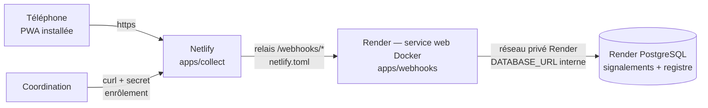

# 🧪 Tester en ligne : Netlify + Render

Ce guide monte un environnement de test pour la collecte (outil [C1](./outils/collecte.md#c1)) et l'identification des observateurs (outil [R5](./outils/reception.md#r5)). Il comprend une PWA publique, un serveur de réception et une base PostgreSQL. C'est la configuration qui a servi à valider les PR #20 et #21 en novembre 2026.

> ⚠️ **Environnement de test uniquement.** Offres gratuites, hébergement hors d'Afrique, pas de disque permanent : **aucune vraie donnée d'observateur**. Pour une mise en production, suivre [DEPLOYMENT.md](./DEPLOYMENT.md) (VPS, Docker).

Dans ce guide, `<pwa>` désigne l'adresse Netlify obtenue (ex. `https://mon-test.netlify.app`) et `<serveur>` celle du service Render (ex. `https://mon-test-webhooks.onrender.com`).

## Vue d'ensemble



- La PWA garde l'adresse `/webhooks/...` : Netlify relaie vers Render. Il n'y a donc pas de CORS, et aucun secret ne va dans le navigateur.
- La base n'accepte **aucune connexion extérieure**, seulement le service Render, par le réseau privé.

## 1. Render : base de données

1. Render → **New → Postgres** : plan **Free**, région **Frankfurt** (la plus proche de l'Afrique de l'Ouest parmi celles de Render), version 16.
2. Laisser l'**IP allowlist vide** : aucun accès depuis l'extérieur.
3. Une fois la base prête, noter l'**Internal Database URL** (onglet *Connections*). Elle contient le mot de passe : ne la coller que dans Render, jamais dans un message, un ticket ou le dépôt.

## 2. Render : serveur de réception

Render → **New → Web Service** → dépôt `AfricTivistes/jokkoondiral` :

| Réglage | Valeur |
|---|---|
| Branche | celle à tester |
| Runtime | **Docker** |
| Dockerfile | `./docker/Dockerfile.webhooks`, contexte `.` |
| Région / plan | Frankfurt / Free |
| Auto-deploy | oui (chaque push redéploie, **si** l'application GitHub de Render est installée sur l'organisation AfricTivistes ; sinon Render clone le dépôt public mais ne voit pas les pushes : relancer avec *Manual Deploy*) |

Variables d'environnement :

| Variable | Valeur | Remarque |
|---|---|---|
| `IDENTIFICATION` | `appareils` | Téléphones activés par lien |
| `STOCKAGE_SIGNALEMENTS` | `postgres` | |
| `REGISTRE_OBSERVATEURS` | `postgres` | |
| `MIGRER_AU_DEMARRAGE` | `1` | Crée les tables au démarrage (`infra/postgres/*.sql`, chaque fichier une seule fois) |
| `JK_SECRET` | `openssl rand -base64 48` | Secret maître. À garder hors du serveur |
| `JK_WEBHOOK_SECRET` | `openssl rand -hex 24` | Protège l'enrôlement |
| `COLLECT_URL` | `<pwa>/` (étape 3) | Sert aux liens d'activation |
| `DATABASE_URL` | **Internal** Database URL de l'étape 1 | À saisir dans le tableau de bord (*Environment*) |
| `NODE_ENV` | `production` | |

Au démarrage, les journaux Render doivent afficher :

```
🧱 Schéma PostgreSQL : 01-init.sql, 02-collecte.sql, 03-observateurs.sql appliqué(s)
🧾 Collecte : protocole incident_electoral@0.1.0
🗄️  Stockage : postgres · identification : appareils (registre postgres)
```

`❌ Collecte désactivée : DATABASE_URL manquant` signifie que la variable n'est pas encore renseignée. Les autres canaux (WhatsApp, SMS, Telegram) fonctionnent quand même.

## 3. Netlify : la PWA

1. Netlify → **Add new site → Import an existing project → GitHub** → `AfricTivistes/jokkoondiral`. Si l'organisation n'apparaît pas, autoriser l'application Netlify sur AfricTivistes.
2. Branche : la même que sur Render. **Laisser les réglages de build vides** : Netlify lit [`netlify.toml`](../netlify.toml). Ce fichier ne construit que `apps/collect`, relaie `/webhooks/*` vers le serveur, ajoute les en-têtes de sécurité et désactive le cache du service worker.
3. Dans `netlify.toml`, l'adresse du serveur (`[[redirects]] to = ...`) doit être `<serveur>/:splat`.
4. Mettre `<pwa>/` dans `COLLECT_URL` côté Render. Render redéploie tout seul.

## 4. Enrôler un observateur (sans NocoDB)

La base est fermée à l'extérieur. On crée donc l'observateur par le webhook protégé, qui renvoie son pseudonyme et son lien à usage unique (48 h) :

```bash
curl -X POST <pwa>/webhooks/api/collect/observateurs/lien \
  -H "Content-Type: application/json" \
  -H "X-Jk-Webhook: $JK_WEBHOOK_SECRET" \
  -d '{"ajouter": {"bureau_vote": "Bureau test 1", "expire_le": "2026-12-31T23:59:59Z"}}'
# → {"ok":true,"code":"OBS-XXXXXX","lien":"<pwa>/#activer=…","expire_le":"…"}
```

Sans l'en-tête, la réponse est `401`. Remettre le lien à l'observateur, sous forme de QR ou par un canal sûr.

## 5. Vérifier

| Scénario | Attendu | Où le voir |
|---|---|---|
| État | `{"ok":true, …"postgres"…}` | `<pwa>/webhooks/api/collect/sante` |
| Activation | Bandeau « Téléphone activé — … OBS-XXXXXX » ; un 2ᵉ appareil avec le même lien est refusé | Téléphone |
| Envoi | « Signalement reçu », numéro `JK-…` | Téléphone ; journaux : `📥 Collecte : JK-… enregistré dans postgres (pending, OBS-…)` |
| Photo | Envoyée après le signalement | Journaux : `🖼️ Collecte : photo reçue pour … (… Ko, sha256 …)` |
| Hors ligne | Mode avion → « En attente d'envoi » → part au retour du réseau | Téléphone, puis journaux |
| Désactivation | Webhook `{"desactiver": "OBS-XXXXXX"}`, puis nouvel envoi refusé : « Votre accès a été désactivé par la coordination » (en moins de 60 s) | Téléphone |

Validé en novembre 2026 : activation d'un observateur de test, puis un signalement enregistré en `pending` dans PostgreSQL.

## Limites de l'offre gratuite

| Limite | Conséquence |
|---|---|
| Mise en veille après ~15 min sans trafic | Premier envoi lent (jusqu'à ~1 min) ; la PWA réessaie toute seule |
| Pas de disque permanent | **Photos et file de reprise perdues** à chaque redéploiement (les signalements, eux, restent en base) |
| Base gratuite qui expire (~30 jours) | Recréer la base, puis remettre `DATABASE_URL` |
| Hébergement hors d'Afrique, offre partagée | Jamais de vraies données d'observateurs |

## Sécurité de l'environnement de test

- **Secrets jetables.** Générer `JK_SECRET` et `JK_WEBHOOK_SECRET` pour le test seulement. Les régénérer s'ils ont circulé (messagerie, conversation, capture d'écran) et ne jamais les réutiliser ailleurs. Changer `JK_SECRET` invalide tous les téléphones activés.
- Base fermée à l'extérieur ; `DATABASE_URL` n'est saisie que dans Render.
- Aucun jeton de base dans le navigateur : la PWA ne connaît que l'adresse `/webhooks`.

## Piloter Render depuis un assistant de code (facultatif)

Render propose un serveur MCP (`https://mcp.render.com/mcp`) que des assistants de code peuvent utiliser. Ils peuvent alors créer la base et le service, régler les variables, suivre les déploiements et lire les journaux. Précautions :
- autoriser l'accès sur un **espace de travail Render dédié aux tests** ;
- saisir soi-même les secrets sensibles, comme `DATABASE_URL`, dans le tableau de bord.

L'outil SQL de ce serveur ne peut pas joindre une base fermée à l'extérieur, et c'est voulu.

## Plus tard : NocoDB et Kobo

Le serveur sait déjà écrire dans **NocoDB** et **KoboToolbox** ([ADR-0011](./decisions/0011-acces-aux-donnees-et-identite.md)), mais ces deux alternatives n'ont pas encore été testées en ligne. Guides : [nocodb-registre.md](./nocodb-registre.md) (registre dans NocoDB) et `.env.example` (variables `KOBO_*`). Un guide de mise en place pas à pas viendra avec ces tests.
