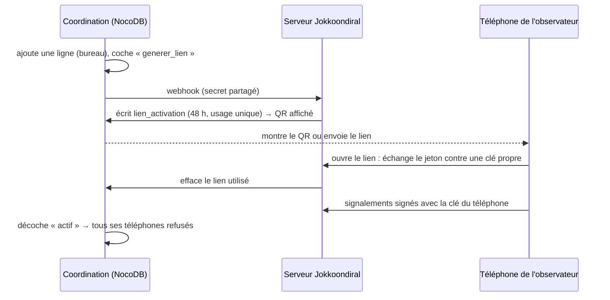

# 🪪 Gérer les observateurs dans NocoDB

La coordination enrôle, active et désactive les observateurs **depuis NocoDB**, comme dans un tableur. Les observateurs n'ont jamais de nom dans le système : seulement un pseudonyme (`OBS-XXXXXX`) et, au besoin, un bureau de vote.

> Configuration du serveur correspondante : `IDENTIFICATION=appareils`, `REGISTRE_OBSERVATEURS=nocodb` (défaut). Décision : [ADR-0011](./decisions/0011-acces-aux-donnees-et-identite.md).

## Comment ça marche



## 1. Créer les tables

**Base PostgreSQL de Jokkoondiral branchée à NocoDB** (installation Docker du dépôt) : les tables sont créées par `infra/postgres/03-observateurs.sql`. NocoDB les affiche après « synchroniser les métadonnées ».

**Autre base NocoDB** (ex. NocoDB cloud) : créer trois tables avec exactement ces noms de colonnes.

| Table | Colonne | Type NocoDB | Rôle |
|---|---|---|---|
| `observateurs` | `observateur_id` | SingleLineText | Identifiant interne (rempli par le serveur) |
| | `code` | SingleLineText | Pseudonyme `OBS-XXXXXX` |
| | `bureau_vote` | SingleLineText | Affectation (facultatif) |
| | `actif` | Checkbox | Décocher = tous ses téléphones refusés |
| | `expire_le` | DateTime | Fin de validité (ex. fin du scrutin) |
| | `telephone_chiffre` | LongText | Numéro chiffré par le serveur (illisible ici) |
| | `generer_lien` | Checkbox | Cocher pour obtenir un nouveau lien |
| | `lien_activation` | LongText | Lien à usage unique (rempli par le serveur) |
| | `qr` | **QR Code** (sur `lien_activation`) | QR à montrer à l'observateur |
| `appareils` | `appareil_id`, `observateur_id`, `empreinte`, `cree_le`, `dernier_usage`, `revoque_le` | SingleLineText / DateTime | Un téléphone activé ; renseigner `revoque_le` le refuse |
| `activations` | `empreinte`, `observateur_id`, `expire_le`, `utilise_le` | SingleLineText / DateTime | Liens émis (empreintes seulement) |

Les tables `appareils` et `activations` ne contiennent que des **empreintes** : ni clé, ni jeton lisible.

## 2. Compte NocoDB dédié au serveur

Créer un utilisateur NocoDB `collecte`, rôle **Éditeur sur cette base uniquement**, puis générer son jeton d'API. Le mettre dans le fichier secret du serveur (`NOCODB_API_TOKEN_FILE`), jamais dans le dépôt ni dans le navigateur. Un jeton compromis se révoque dans NocoDB sans toucher aux comptes des coordinateurs.

## 3. Webhook « générer le lien »

Dans la table `observateurs` : **Webhooks → Nouveau**.

| Réglage | Valeur |
|---|---|
| Événement | Après mise à jour (et après insertion, si souhaité) |
| Condition | `generer_lien` est coché |
| Méthode / URL | `POST http://webhooks:3000/api/collect/observateurs/lien` (réseau interne Docker) |
| En-tête | `X-Jk-Webhook: <valeur de JK_WEBHOOK_SECRET>` |

Le serveur génère le lien, l'écrit dans `lien_activation` et décoche `generer_lien`. Sans webhook, le même résultat s'obtient en ligne de commande :

```bash
pnpm observateurs ajouter --bureau "Bureau 12" --expire 2027-01-26
pnpm observateurs lien OBS-7K2Q9M
pnpm observateurs desactiver OBS-7K2Q9M
pnpm observateurs importer equipe.csv      # colonnes : bureau_vote,expire_le,telephone
```

### Sans NocoDB (registre PostgreSQL seul)

Le même webhook, appelé avec le secret, sait aussi **créer** un observateur et renvoie son lien :

```bash
curl -X POST https://votre-domaine.org/webhooks/api/collect/observateurs/lien \
  -H "Content-Type: application/json" -H "X-Jk-Webhook: $JK_WEBHOOK_SECRET" \
  -d '{"ajouter": {"bureau_vote": "Bureau 12", "expire_le": "2027-01-26T23:59:59Z"}}'
# → {"ok":true,"code":"OBS-7K2Q9M","lien":"https://…/collect/#activer=…","expire_le":"…"}
```

Pour couper l'accès d'un observateur (tous ses téléphones, effet en 60 s au plus) :

```bash
curl -X POST https://votre-domaine.org/webhooks/api/collect/observateurs/lien \
  -H "Content-Type: application/json" -H "X-Jk-Webhook: $JK_WEBHOOK_SECRET" \
  -d '{"desactiver": "OBS-7K2Q9M"}'
```

Gardez ce secret hors des messageries : il permet de créer et de désactiver des observateurs.

## 4. Au quotidien

| Situation | Action dans NocoDB |
|---|---|
| Nouvel observateur | Ajouter une ligne (`actif` coché), cocher `generer_lien`, montrer le QR |
| Téléphone perdu, saisi ou changé | Table `appareils` : renseigner `revoque_le`, puis nouveau lien pour le nouveau téléphone |
| Observateur qui arrête | Décocher `actif` |
| Fin du scrutin | `expire_le` fait le travail tout seul |
| Lien expiré (48 h) ou déjà utilisé | Cocher à nouveau `generer_lien` |

Une désactivation prend effet en **60 secondes au plus**. Transmettez les liens par un canal sûr : en main propre (QR), ou via une messagerie chiffrée. Un lien ne sert qu'une fois et ne contient aucune donnée personnelle.
