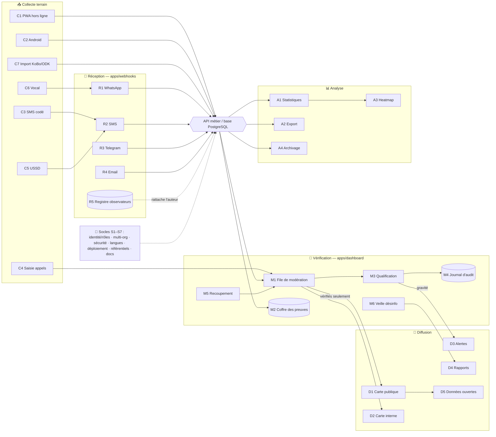

# 🧰 Catalogue des outils — Jokkoondiral

Jokkoondiral n'est pas une application unique mais une **boîte à outils de 34 outils**, répartis en **5 domaines + des socles transverses**. Chaque outil a un **code** (C1, R2, M3…) utilisé partout : fiches, matrice des besoins, phasage, issues GitHub et pull requests.

> **Origine.** Ce catalogue reprend le document « Jokkoondiral — Orientation des besoins » (oct. 2026), construit à partir de la consultation Jokkoondiral (45 organisations de la société civile, 18 pays). Les besoins qui justifient chaque outil sont dans [`docs/BESOINS.md`](../BESOINS.md).

## Les six familles

| Famille | Codes | Question à laquelle elle répond | Outils | Fiches |
|---|---|---|---|---|
| 📥 **Collecte terrain** | C1–C7 | Comment l'observateur envoie-t-il un signalement, quel que soit son téléphone et son réseau ? | 7 | [collecte.md](./collecte.md) |
| 📡 **Réception multi-canal** | R1–R5 | Comment chaque canal devient-il un signalement normalisé, rattaché à un observateur connu ? | 5 | [reception.md](./reception.md) |
| 🔎 **Vérification et modération** | M1–M6 | Comment vérifier, qualifier et tracer chaque décision avant toute publication ? | 6 | [verification.md](./verification.md) |
| 📢 **Diffusion et alertes** | D1–D5 | Comment montrer au public ce qui est vérifié et prévenir l'équipe de ce qui est urgent ? | 5 | [diffusion.md](./diffusion.md) |
| 📊 **Analyse et archives** | A1–A4 | Que deviennent les données après le scrutin (rapports, plaidoyer, effacement) ? | 4 | [analyse.md](./analyse.md) |
| 🧱 **Socles transverses** | S1–S7 | Sur quoi tous les autres outils reposent-ils (identité, sécurité, langues, déploiement…) ? | 7 | [socles.md](./socles.md) |

> Le préfixe de la vérification est **M** (modération) et non V, pour ne pas confondre avec les phases V1 / V2.

## Vue d'ensemble

**Règle de flux.** Toutes les applications passent par un point d'accès unique à la base (aujourd'hui l'API NocoDB, demain une petite API métier — voir [ADR-0002](../decisions/0002-couche-acces-donnees.md)). Le public ne voit **que** les incidents au statut `verified`, sans aucun champ observateur.

## Les 34 outils

Légende état : 🟡 **Amorcé** = du code, un schéma ou une configuration existe · ⚪ **À créer** = rien dans le dépôt. Phases : voir [`ROADMAP.md`](../ROADMAP.md).

| Code | Outil | Phase | État | Où dans le monorepo |
|---|---|---|---|---|
| [C1](./collecte.md#c1) | Formulaire web hors ligne (PWA) | MVP | 🟡 Amorcé | `apps/collect`, `packages/protocole` |
| [C2](./collecte.md#c2) | Application Android hors ligne | V1 | ⚪ À créer | `apps/android` (si native) ; sinon configuration ODK documentée dans docs/ |
| [C3](./collecte.md#c3) | Parcours SMS codé | MVP | ⚪ À créer | `apps/webhooks/src/parsers/sms.ts`, codes dans `packages/shared/src/constants.ts` |
| [C4](./collecte.md#c4) | Saisie des appels par un opérateur | V1 | ⚪ À créer | `apps/dashboard`, ressource « nouveau signalement » |
| [C5](./collecte.md#c5) | USSD | V2 | ⚪ À créer | `apps/webhooks/src/handlers/ussd.ts` |
| [C6](./collecte.md#c6) | Signalement vocal en langues nationales | V2 | ⚪ À créer | service optionnel `apps/voice` appelé par M2 |
| [C7](./collecte.md#c7) | Import KoBo / ODK | V1 | ⚪ À créer | `scripts/import-kobo` puis connecteur dans `apps/webhooks` |
| [R1](./reception.md#r1) | Passerelle WhatsApp | MVP | 🟡 Amorcé | `apps/webhooks/src/handlers/whatsapp.ts` |
| [R2](./reception.md#r2) | Passerelle SMS | MVP | 🟡 Amorcé | `apps/webhooks/src/handlers/sms.ts` |
| [R3](./reception.md#r3) | Bot Telegram | maintenu | 🟡 Amorcé | `apps/webhooks/src/handlers/telegram.ts` |
| [R4](./reception.md#r4) | Email entrant | V2 | ⚪ À créer | `apps/webhooks/src/handlers/email.ts` |
| [R5](./reception.md#r5) | Registre des observateurs | MVP | 🟡 Amorcé | `infra/postgres` (table observers, suggérée dans `docs/SCHEMA.md`), écrans dans `apps/dashboard` |
| [M1](./verification.md#m1) | File de modération | MVP | 🟡 Amorcé | `apps/dashboard` |
| [M2](./verification.md#m2) | Coffre des preuves | MVP | 🟡 Amorcé | module partagé appelé par `apps/webhooks` ; table evidences dans `infra/postgres` |
| [M3](./verification.md#m3) | Qualification de l'incident | MVP | 🟡 Amorcé | `infra/postgres` (table election_incidents, suggérée dans `docs/SCHEMA.md`), types dans `packages/shared/src/types.ts` |
| [M4](./verification.md#m4) | Journal d'audit | MVP | ⚪ À créer | `infra/postgres` |
| [M5](./verification.md#m5) | Recoupement et doublons | V1 | ⚪ À créer | vue SQL + panneau dans `apps/dashboard` |
| [M6](./verification.md#m6) | Veille désinformation et fact-checking | V2 | ⚪ À créer | ressource « rumeurs » dans `apps/dashboard`, publication dans `apps/public` |
| [D1](./diffusion.md#d1) | Carte publique | MVP | 🟡 Amorcé | `apps/public` |
| [D2](./diffusion.md#d2) | Carte interne temps réel | MVP | ⚪ À créer | `apps/dashboard` |
| [D3](./diffusion.md#d3) | Alertes sortantes | V1 | ⚪ À créer | `apps/webhooks/src/notify/` (service d'envoi), règles configurables dans `apps/dashboard` |
| [D4](./diffusion.md#d4) | Rapports publics | V2 | ⚪ À créer | `apps/public` |
| [D5](./diffusion.md#d5) | Données ouvertes | V2 | ⚪ À créer | `apps/public` |
| [A1](./analyse.md#a1) | Tableau de bord statistiques | V1 | ⚪ À créer | `apps/dashboard` |
| [A2](./analyse.md#a2) | Export | V1 | ⚪ À créer | bouton dans `apps/dashboard`, script dans scripts/ |
| [A3](./analyse.md#a3) | Carte de densité et clusters | V2 | ⚪ À créer | `apps/dashboard` et `apps/public` |
| [A4](./analyse.md#a4) | Archivage et conservation | V1 | ⚪ À créer | scripts/ et infra/ |
| [S1](./socles.md#s1) | Identité, rôles et double authentification | MVP | 🟡 Amorcé | `apps/dashboard/src/providers/authProvider.ts`, rôles dans `packages/shared/src/types.ts` (UserRole existe) |
| [S2](./socles.md#s2) | Multi-organisations | V1 | ⚪ À créer | `infra/postgres`, filtres dans toutes les apps |
| [S3](./socles.md#s3) | Sécurité et protection des observateurs | MVP, continu | 🟡 Amorcé | infra/, `docker/nginx/`, revue transverse de toutes les apps |
| [S4](./socles.md#s4) | Langues | MVP (FR/EN), V2 (langues nationales) | ⚪ À créer | `packages/shared/src/i18n/` |
| [S5](./socles.md#s5) | Déploiement et hébergement | MVP (auto-hébergé), V1 (mode hébergé) | 🟡 Amorcé | docker/, docker-compose.yml, `scripts/setup.sh`, `docs/DEPLOYMENT.md` |
| [S6](./socles.md#s6) | Référentiels | MVP | ⚪ À créer | `infra/postgres`, `scripts/seed` |
| [S7](./socles.md#s7) | Documentation et guides | MVP, continu | 🟡 Amorcé | docs/ (existe : ARCHITECTURE, SCHEMA, DEPLOYMENT…) |

**Bilan :** 13 outils amorcés, 21 à créer. Le socle d'infrastructure (Docker, PostgreSQL, NocoDB, Nginx, monorepo pnpm, types partagés) est en place et ne doit pas être refait.

## Contenu d'une fiche

| Rubrique | Contenu |
|---|---|
| **Rôle** | Ce que fait l'outil, en une phrase |
| **Données** | Chiffres de la consultation qui le justifient |
| **Briques open source** | Ce qu'on réutilise plutôt que de le réécrire |
| **Où** | Emplacement dans le monorepo |
| **État** | Ce qui existe aujourd'hui |
| **Phase** | MVP, V1 ou V2 |
| **Profil** | Type de contributeur attendu ([SKILLS_MAP.md](../../SKILLS_MAP.md)) |
| **Premières tâches** | De quoi ouvrir les premières issues |

## Comment contribuer à un outil

1. Choisis un outil dans le tableau (ou par profil dans [SKILLS_MAP.md](../../SKILLS_MAP.md)).
2. Lis sa fiche, puis cherche les issues dont le titre commence par son code (`[R1]`).
3. Pas d'issue pour ta tâche ? Ouvre-la avec le modèle **« Tâche sur un outil »** : titre `[R1] Télécharger les médias WhatsApp`.
4. Tu veux proposer un **nouvel outil** ? Lis [AJOUTER_UN_OUTIL.md](../AJOUTER_UN_OUTIL.md).

Un outil de phase V1 ou V2 n'est pas « facultatif » : tu peux le commencer dès maintenant s'il ne bloque pas le MVP.
