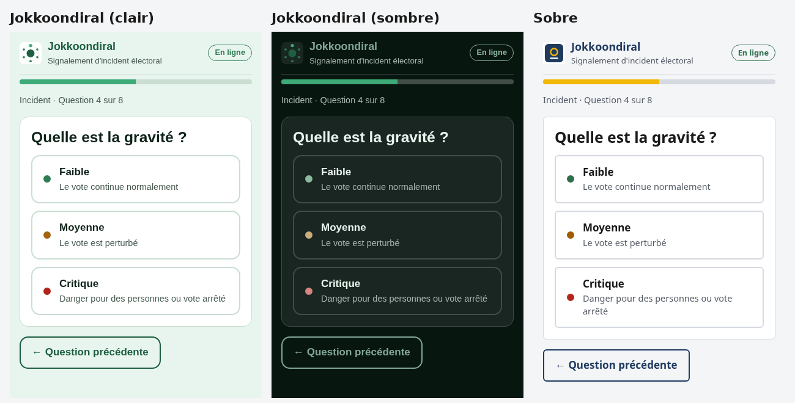

# 🎨 Personnaliser le design (couleurs, logo, polices)

Une OSC change l'apparence de la PWA de collecte **sans toucher au CSS ni au code** : tout passe par un fichier de thème. Le build vérifie automatiquement que le résultat reste lisible.



## En 3 étapes

1. **Copier un thème** existant :

   ```bash
   cp -r apps/collect/config/themes/jokkoondiral apps/collect/config/themes/mon-osc
   ```

2. **Modifier** `apps/collect/config/themes/mon-osc/theme.json` (couleurs, polices, angles) et remplacer `logo.svg` / `icone.svg` par les vôtres.
3. **Le choisir** dans `apps/collect/config/instance.json` (`"theme": "mon-osc"`), puis `pnpm --filter collect build`.

Pour essayer sans rien modifier : `JK_THEME=sobre pnpm --filter collect build` (ou `--build-arg JK_THEME=sobre` avec Docker).

Pour changer une seule couleur d'un thème existant, sans le copier, utilisez `theme_surcharges` dans `instance.json` :

```json
"theme": "jokkoondiral",
"theme_surcharges": { "couleurs": { "primaire": "#7A1F3D" } }
```

## Les couleurs d'un thème

| Jeton | Sert à |
|---|---|
| `primaire` / `texte_sur_primaire` | Boutons principaux, liens, titres de marque / texte écrit dessus |
| `secondaire` | Survol, éléments secondaires |
| `accent` / `texte_sur_accent` | Barre de progression, focus, repères / texte écrit dessus |
| `fond`, `surface` | Fond de page, fond des cartes |
| `texte`, `texte_doux`, `bordure` | Texte courant, texte secondaire, séparateurs |
| `gravite_faible`, `gravite_moyenne`, `gravite_critique` | Pastilles de gravité |
| `succes`, `alerte`, `erreur` | États (envoyé, hors ligne, erreur) |

Autres réglages : `polices.texte`, `polices.titres` (polices **installées sur le téléphone** : l'app n'en télécharge aucune, pour rester hors ligne), `rayon` (0 à 32 px), `taille_base` (16 à 20 px), `logo`, `icone` (icône d'installation et d'en-tête), `mode_sombre` (`"auto"`, `"desactive"` ou des couleurs sombres fournies).

## Les garde-fous

- **Contraste** : le build échoue si un texte est illisible (WCAG AA : 4,5:1 pour le texte, 3:1 pour les pastilles de gravité). Le message dit quelle paire de couleurs corriger.
- **Mode sombre** : dérivé automatiquement de votre palette ; s'il n'est pas assez lisible, il est simplement désactivé (avertissement au build).
- **Cibles tactiles** : 48 px minimum, non modifiable.
- **Aucune couleur en dur** dans le code de l'app : un test l'interdit, pour qu'un thème s'applique vraiment partout.

## Ce que le thème change

L'interface (variables CSS `--jk-*`), la couleur de la barre du navigateur, le **manifest** (nom, couleurs, icône d'installation), le favicon et le logo. Le nom affiché et les textes d'accueil, eux, sont dans `instance.json`.

Les mêmes jetons sont exportés par `@jokkoondiral/shared` (`theme.ts`) pour que le site public (D1) et le dashboard puissent adopter le même thème.
